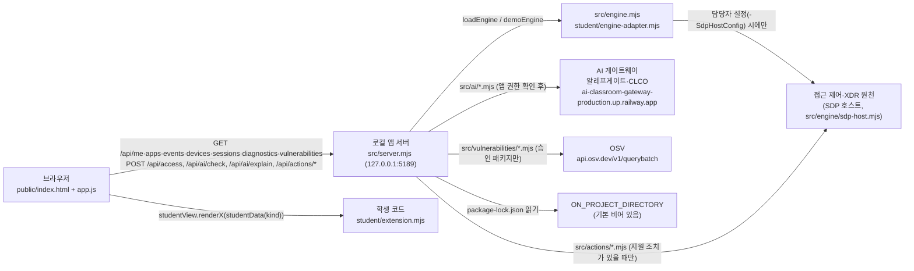

# 케셰브 학생 실행 설명서 (21단계 · 학생 작성)

이 문서는 학생이 직접 작성한 문서입니다. 제공 문서(`README.md`, `docs/STUDENT_LAUNCH_GUIDE.md` 등)는 고치지 않고, 이 저장소에서 실제로 확인한 내용만 따로 정리합니다.
**확인함**은 2026-10-26에 이 PC에서 직접 실행해 본 것이고, **모의 점검**은 가짜 입력으로 학생 함수만 돌려 본 것이며, **미확인**은 실행하지 않은 것입니다.

## 1. 목적·기능·구성·지원 환경

| 항목 | 내용 |
|---|---|
| 목적 | 회사 직원이 자기 로그인·기기·세션 상태, 업무 앱 접근 판정, 접속·XDR 보안 기록, AI 사건 설명, 조치 상태, 설치 패키지 취약점 정보를 한 화면에서 확인하는 보안 Agent 앱 「케셰브」 |
| 기능 | 현재 로그인 표시(13) · 접근 판정(14) · 보안 기록 목록·필터·상세(15) · 알림·기기·세션·도움정보(16) · AI 연결 점검(17) · 근거 있는 AI 사건 설명(18) · 조치 요청 상태와 실제 결과 구분(19) · 설치 패키지와 OSV 취약점 대조(20) |
| 구성 | 브라우저 화면(`public/`) → 로컬 앱 서버(`src/server.mjs`, 127.0.0.1 전용) → 접근 제어·XDR 원천(SDP 호스트 어댑터) / AI 게이트웨이(알레프게이트·CLCO) / OSV 조회. 학생 코드는 `student/extension.mjs` 하나 |
| 시작 틀 버전 | `package.json` 의 `alekov-client-starter` **0.2.11** (README 제목도 0.2.11). 서버 진단 응답의 `version` 은 `0.1.0` 으로 나옴(제공 코드 값) |
| Node.js | `package.json` `engines.node` = **24.19.0**(수업 기준). 실행 도구 `tools/start-alekov.ps1` 은 22~24 를 허용하고 24.19.0 이 아니면 "참고" 문구만 보여 줌. **이 PC에서 확인한 버전은 v24.11.0** (24.19.0 에서는 미확인) |
| 외부 npm 의존성 | 없음. `package-lock.json`·`node_modules` 없이 `node` 만으로 실행됨(확인함) |
| 운영체제 | Windows 11 + PowerShell 에서만 확인함. macOS·Linux 는 미확인(실행 도구가 `.ps1` 이라 Windows 기준) |

## 2. 폴더 구조와 작업 위치

```
<프로젝트 폴더>\                     ← Git 최상위(git clone 한 폴더). 커밋·push·제출은 여기 기준
├─ api\, src\, public\ ...           ← 1~12단계 프로젝트(Vercel 배포). 케셰브 실행과 무관
└─ on-client\                        ← 앱 폴더. PowerShell 은 여기서 연다
   ├─ package.json                   ← start / demo / check 스크립트
   ├─ .env.example                   ← 비밀 없는 설정 견본(ON_PORT=5189 등). 실제 값은 .env(커밋 제외)
   ├─ tools\start-alekov.ps1         ← 제공 실행 도구(Node 버전·폴더·포트 확인 후 서버 실행)
   ├─ src\server.mjs                 ← 제공 로컬 HTTP 서버(127.0.0.1)
   ├─ src\engine.mjs                 ← 제공: 원천 연결 로더 + 예제 엔진(demoEngine)
   ├─ src\engine\sdp-host*.mjs       ← 제공: 담당자 설정 시 SDP 호스트 연결
   ├─ src\ai\*.mjs                   ← 제공: AI 게이트웨이 연결·권한 확인
   ├─ src\actions\*.mjs              ← 제공: 조치 준비·집행·결과 조회(기본은 미지원)
   ├─ src\vulnerabilities\*.mjs      ← 제공: package-lock.json 읽기 + OSV 조회
   ├─ public\index.html, app.js ...  ← 제공 화면. app.js 가 학생 함수를 부름
   ├─ student\engine-adapter.mjs     ← 원천 연결 어댑터(기본 disconnected)
   ├─ student\extension.mjs          ← ★ 학생 작성(13~20단계 render 함수 8개)
   └─ docs\STUDENT_RUNBOOK.md        ← ★ 이 문서(학생 작성)
```

## 3. 실행·종료·재실행 절차

### 3-1. PowerShell 여는 위치
파일 탐색기에서 `<프로젝트 폴더>\on-client` 를 열고 주소 표시줄에 `powershell` 입력 → Enter. 문서의 명령은 모두 이 폴더 기준 상대 경로이며 특정 PC의 절대 경로에 의존하지 않습니다.

### 3-2. 실행 명령

| 방법 | 명령(앱 폴더에서) | 열 주소 | 이 PC 확인 |
|---|---|---|---|
| 제공 실행 도구(권장) | `powershell -NoProfile -ExecutionPolicy Bypass -File .\tools\start-alekov.ps1` | http://127.0.0.1:5189/ | **미확인** — 이번 작업 환경에서 `-ExecutionPolicy Bypass` 실행이 권한 정책으로 막혀 돌리지 못함. 사람이 직접 실행해 확인할 것 |
| npm | `npm start` (= `node src/server.mjs`) | http://127.0.0.1:5189/ | 확인함(같은 명령 `node src/server.mjs` 를 `ON_PORT=5189` 로 직접 실행) |
| 예제 자료 | `npm run demo` (= `node src/server.mjs --demo`) | http://127.0.0.1:5189/ | 확인함(포트 5190 으로 실행: `ON_PORT=5190`) |
| 다른 포트 | 실행 도구 끝에 ` -Port 5190`, npm 이면 `$env:ON_PORT=5190; npm start` | http://127.0.0.1:5190/ | 포트 변경은 확인함(5190) |
| 학생 코드 문법 검사 | `npm run check` (= `node --check student/extension.mjs`) | — | 확인함(오류 없음) |

### 3-3. 정상 시작 신호
- 실행 도구: `케셰브가 켜졌습니다. 브라우저에서 http://127.0.0.1:5189/ 을 여세요.` 와 `서버가 응답한 것만 확인했습니다. AI 연결 상태는 화면에서 따로 확인해 주세요.` (스크립트 원문 기준, 이 PC 미실행)
- `npm start` / `node src/server.mjs`: 콘솔에 `케셰브 연결 확인: http://127.0.0.1:5189` (확인함)
- `npm run demo`: `케셰브 예제: http://127.0.0.1:5189` (확인함, 5190 으로 실행 시 `:5190`)
- Node 24 에서는 `ExperimentalWarning: SQLite is an experimental feature` 경고가 함께 나오지만 서버는 정상 응답함(확인함, 조치 저장소가 `node:sqlite` 사용).
- 브라우저에서 위쪽 상태와 「보호 현황」 화면이 보이면 정상. `GET /` 가 200 으로 응답함(확인함).

**서버가 켜졌다는 것은 AI 연결·SDP 연결 성공이 아닙니다.** 기본 실행은 원천이 연결되지 않은 `disconnected` 이고, 예제 모드는 `demo` 자료입니다.

### 3-4. 종료와 재실행
- 종료: 서버를 띄운 PowerShell 창에서 `Ctrl+C`. 브라우저 주소가 더 이상 열리지 않으면 종료된 것(이번 확인에서는 프로세스를 종료한 뒤 `curl` 응답이 `000`(연결 불가)으로 바뀐 것을 확인).
- `-Background` 로 띄운 경우: 실행 도구가 알려 준 「프로세스 번호」의 node 를 작업 관리자에서 종료.
- 재실행: 같은 `on-client` 폴더에서 3-2 명령을 다시 실행. 실행·종료는 학생 파일을 바꾸지 않음.

## 4. 시스템 구성도

### 4-1. Mermaid



### 4-2. 같은 내용(글)

```
[브라우저: public/index.html·app.js] --HTTP(127.0.0.1)--> [로컬 앱 서버: src/server.mjs]
        |                                                   |-- src/engine.mjs ---------> [접근 제어·XDR 원천(SDP)]  기본: 연결 없음(disconnected), --demo: 예제 자료
        | 응답을 studentData()로 정리                         |-- src/ai/*.mjs -----------> [AI 게이트웨이(알레프게이트·CLCO)]  기본: 권한 준비 중
        v                                                   |-- src/actions/*.mjs ------> [원천 조치 집행]  기본: 미지원
[학생 칸: student/extension.mjs render 함수 8개]             '-- src/vulnerabilities/*.mjs -> [OSV]  기본: 프로젝트 설정 없음(not_configured)
```

### 4-3. 데이터 흐름 표

| 화면 칸 | 브라우저 요청 | 서버 모듈 | 학생 함수 입력(app.js `studentData`) |
|---|---|---|---|
| 현재 로그인 | GET /api/me, /api/devices, /api/sessions | engine `readIdentity`·`readDevices`·`readSessions` | `{me, devices, sessions, mode}` → `renderIdentity` |
| 접근 판정 | POST /api/access | engine `decideAccess` | `{status, mode, data?, error?}` → `renderDecision` |
| 보안 기록 | GET /api/events | engine `readEvents` | 같은 모양 → `renderEvents` |
| 상태·알림 | GET /api/diagnostics 등 | server | `{devices, sessions, notifications, diagnostics, mode}` → `renderStatus` |
| AI 연결 | POST /api/ai/check | src/ai | `{status, mode, data?, error?, checkedAt, explanationAccepted}` → `renderAiConnection` |
| AI 설명 | POST /api/ai/explain | src/ai | `{event, explanation, checkedAt}` → `renderExplanation` |
| 조치 | POST /api/actions/prepare·execute·result | src/actions | `{status, event, actionId, target, receipt, observation, ...}` → `renderAction` |
| 패키지 | GET /api/vulnerabilities | src/vulnerabilities | `{status, mode, data?, error?}` → `renderVulnerabilities` |

비밀값(앱 열쇠·토큰·인증서)은 서버 쪽 설정 파일·환경변수에만 있고 이 문서·저장소·브라우저로 오지 않습니다. 위 주소는 제공 코드(`src/ai/connection.mjs`, `src/vulnerabilities/README.md`)에 적힌 공개 주소입니다.

## 5. 제공 부분과 학생 작성 부분

| 구분 | 파일·함수 | 단계 | 학생이 한 일 |
|---|---|---|---|
| 학생 | `student/extension.mjs` `renderIdentity` (238행 부근) | 13 | 사용자·기기·세션 상태별 표시, unknown 주의, mode 안내 |
| 학생 | `renderDecision` (299행 부근) | 14 | allow/deny/challenge/unknown, 미등록 값은 unknown |
| 학생 | `renderEvents` (345행 부근) | 15 | 최신순 정렬(원본 불변), 필터 3개, 상세 |
| 학생 | `renderStatus` (487행 부근) | 16 | 알림·기기·세션·진단, 「도움정보 복사」(비밀 없는 6필드) |
| 학생 | `renderVulnerabilities` (584행 부근) | 20 | 설치 버전·OSV 결과·출처·시각, 미조회≠취약점 없음, 늦은 응답 차단 |
| 학생 | `renderAiConnection` (691행 부근) | 17 | test/verified 구분, 오류 유형별 복구 안내 |
| 학생 | `renderExplanation` (767행 부근) | 18 | 근거 ID 대조, 규칙, unknown 상태, 제안 미실행 |
| 학생 | `renderAction` (876행 부근) | 19 | 상태 11개 구분, ACK≠성공, effectApplied 관측만 효과 확인 |
| 학생 | `docs/STUDENT_RUNBOOK.md` | 21 | 이 문서 |
| 제공 | `public/index.html`, `public/app.js`, `public/vulnerabilities-view.mjs`, `public/ai-connect.mjs`, `style.css` | — | 수정하지 않음. 버튼·요청·세대(generation) 관리·응답 검증은 제공 코드가 함 |
| 제공 | `src/**` (서버·엔진·AI·조치·OSV·연결) | — | 수정하지 않음 |
| 제공 | `tools/*.ps1`, `README.md`, `docs/*`(이 문서 제외), `student/engine-adapter.mjs` | — | 수정하지 않음 |

경계: 학생 함수는 입력을 받아 **DOM 요소 하나를 돌려줄 뿐**이며(`createElement`+`textContent`, innerHTML 없음), 네트워크 요청·버튼 동작·확인 티켓을 갖지 않습니다. 학생 함수가 예외를 던지면 `public/app.js` `renderStudent` 가 그 칸에 「학생 구현 renderX 실행 중 오류가 발생했습니다. 제공 UI는 계속 동작합니다.」를 표시합니다.

## 6. 확인한 기능 (2026-10-26, Windows 11, Node v24.11.0)

| 기능 | 방법 | 결과 |
|---|---|---|
| 서버 기동·`GET /` 200 | `node src/server.mjs`(5189), `node src/server.mjs --demo`(5190) | 확인함 |
| 기본 모드 원천 미연결 | `GET /api/me`·`/api/events`·`/api/devices` | 확인함: `ENGINE_NOT_CONNECTED`, `mode: disconnected` |
| 기본·예제 모드 진단 | `GET /api/diagnostics` | 확인함: `engine.code` 가 각각 `ENGINE_NOT_CONNECTED`, `DEMO_ONLY` |
| 패키지 조회 | 예제 화면 「설치 패키지 조회」 | 확인함: `not_configured`(`PROJECT_NOT_CONFIGURED`), 학생 칸 "조회 준비 미완료 … 취약점 없음이 아닙니다" |
| 접근 판정 | 예제 화면 「개발 저장소 접속 요청」 | 확인함: 학생 칸 "접근 거부(deny)", 사유·판정 시각 |
| 학생 칸 8개 렌더링 | 예제 화면 첫 로드 | 확인함: 8칸 모두 오류 없이 표시(사용자·기기 unknown 주의, 기록 1건, 설명 "기록을 먼저 고르세요", 조치 "아직 미실행(idle)") |
| AI 설명 실패 경로 | 예제 화면 「AI 설명 요청」(AI 미설정) | 확인함: `ON_AI_PROVISIONING_PENDING`, "기록은 그대로입니다" — 외부 AI 요청은 나가지 않음 |
| 학생 함수 상태별 분기 | scratchpad 가짜 DOM 시험(18·19·20단계) | 모의 점검: 설명 8가지, 조치 10가지, 패키지 7가지 상태 |

## 7. 미확인·지원하지 않는 범위

| 항목 | 상태 | 이유 |
|---|---|---|
| `tools/start-alekov.ps1` 실행 | 미확인 | 이번 작업 환경에서 실행 정책 우회 명령이 막힘. 스크립트 원문만 읽음 |
| Node.js 24.19.0 | 미확인 | 이 PC는 v24.11.0 |
| SDP 원천 실제 연결(`-SdpHostConfig`) | 미확인 | 담당자 개인 설정 파일 없음 |
| 앱 안 AI 실제 연결·설명 성공(`verified`) | 미확인 | 학생 앱 이용 권한 미발급(`ON_AI_PROVISIONING_PENDING`). 유료 요청을 시험 삼아 반복하지 않음 |
| 조치 실제 집행·결과 재조회 | 미확인 | 예제 기록의 `supportedActions` 가 비어 있어 「조치 준비」 경로가 열리지 않음. 시험 집행 금지 |
| OSV 외부 조회(`complete`/`partial`) | 미확인 | `ON_PROJECT_DIRECTORY`·`ON_APPROVED_PUBLIC_PACKAGES` 미설정 |
| macOS·Linux | 지원 확인 안 함 | 실행 도구가 Windows PowerShell 기준 |
| 공식 판정 | — | 서버 AI 가 커밋 코드를 읽고 판정하며 앱을 실행하지 않음. 내 화면 결과가 판정을 대신하지 않음 |

## 8. 오류별 확인 순서와 복구

| 증상·코드 | 어디서 나오나(실제 처리) | 확인 순서 | 복구 |
|---|---|---|---|
| `Node.js 가 없습니다` / `지금 Node.js 는 vXX 입니다` | `tools/start-alekov.ps1` 2) Node 확인 | `node --version` | Node 22~24(권장 24.19.0) 설치 → 새 PowerShell |
| `포트 5189 를 다른 프로그램이 쓰고 있습니다` | 실행 도구 3) 포트 확인 | 다른 케셰브 창이 켜져 있는지 | 그 프로그램은 두고 `-Port 5190`(npm 이면 `$env:ON_PORT=5190`) |
| `앱 폴더가 아닙니다` / `시작 틀 폴더가 아닙니다` | 실행 도구 1) 폴더 확인(`package.json` name = `alekov-client-starter`) | 현재 폴더가 `on-client` 인지 | `on-client` 에서 다시 실행 |
| `…초 안에 뜨지 않았습니다` | 실행 도구 5) 대기 | 창 메시지 전체 | 메시지와 도움정보를 강사에게 전달 |
| `ENGINE_NOT_CONNECTED` (503) | `src/engine.mjs` `disconnected` / `src/server.mjs` safeErrors | 기본 실행인지(어댑터 미연결), 진단 `engine.code` | 정상 동작(원천 미연결). 화면 확인은 `npm run demo`. 실제 연결은 담당자 안내 |
| `HOST_REJECTED` (403) | `src/server.mjs` 허용 Host 검사 | 주소창이 `127.0.0.1:포트` 또는 `localhost:포트` 인지(서버 허용 Host 는 이 두 가지뿐) | 안내된 주소로 다시 열기 |
| `ORIGIN_REJECTED` (403) | `src/server.mjs` cross-site 요청 거부 | 다른 사이트에서 API 를 부르지 않았는지 | 앱 화면에서 다시 요청 |
| `ON_AI_PROVISIONING_PENDING` | `src/ai` 서버 → `app.js` `AI_MESSAGES` → 학생 칸 "AI 설명 실패" | AI 연결 칸 「현재 API 연결 점검」 결과 | 담당자에게 앱 이용 권한 확인. 열쇠를 복사·입력하지 않음. 보안 기록·판정은 계속 사용 |
| `ON_AI_INVALID_INPUT` / `ON_AI_INVALID_OUTPUT` | `app.js` `safeEventForAi`·`validExplanation` → 학생 `renderExplanation` "근거 부족/근거 불일치" | 선택한 기록에 근거·규칙이 있는지 | 다른 기록 선택 또는 다시 요청. 근거를 지어내지 않음 |
| `ACTION_TIMEOUT` → `unknown` | `app.js` `actionFailure` → 학생 `renderAction` "결과 불명" | — | 다시 집행하지 말고 「원천 결과만 재조회」 |
| `ACTION_CONFIRMATION_EXPIRED` → `expired` | `app.js` 만료 타이머 | 확인 기한 | 보안 기록에서 다시 준비 |
| `PROJECT_NOT_CONFIGURED` / `NO_APPROVED_PACKAGES` | `src/vulnerabilities` → 학생 `renderVulnerabilities` | `.env` 의 `ON_PROJECT_DIRECTORY`·`ON_APPROVED_PUBLIC_PACKAGES` | 담당자가 허용 목록을 정할 때까지 정상(취약점 없음 아님) |
| `TIMEOUT` / `CANCELLED`(패키지) | `app.js` `loadVulnerabilities`·`cancelVulnerabilities` | — | 「설치 패키지 조회」를 직접 다시 누름(새 요청) |
| 학생 칸에 "학생 구현 renderX 실행 중 오류" | `app.js` `renderStudent` try/catch | `npm run check`, 브라우저 콘솔 | `student/extension.mjs` 수정 후 브라우저 새로고침 |

도움정보: 「보호 현황」의 「도움정보 불러오기」 → 내용 확인 → 「확인했으며 복사합니다」. 비밀값이 들어가지 않으며 자동 전송하지 않습니다.
